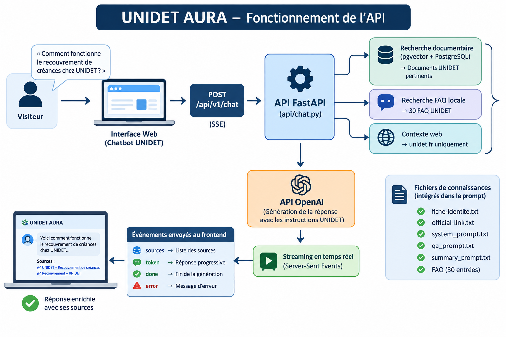

# UNIDET AURA - **Assistant intelligent conversationnel d'UNIDET**

UNIDET AURA est un assistant intelligent conçu pour faciliter l'accès aux informations relatives à [UNIDET](https://unidet.com/), à ses services et à ses activités.

Il permet aux visiteurs de poser leurs questions en langage naturel et d'obtenir des réponses contextualisées à partir des ressources documentaires de l'organisation.


---

## 1. Objectifs du projet

UNIDET AURA vise à :

- Fournir une assistance aux visiteurs en continu.
- Répondre automatiquement aux questions courantes.
- Exploiter les informations publiées sur le site officiel d'UNIDET.
- Retrouver les informations pertinentes dans une base documentaire.
- Orienter les visiteurs vers les ressources et liens officiels.
- Réduire les interventions humaines pour les demandes récurrentes.

## 2. Architecture technique

Le projet repose sur une architecture composée de plusieurs éléments :

| Composant | Technologie | Rôle |
|---|---|---|
| Backend | Python / FastAPI | Gestion des requêtes et orchestration |
| Base de données | PostgreSQL | Stockage documentaire |
| Recherche vectorielle | pgvector | Recherche sémantique |
| Intelligence artificielle | API OpenAI | Compréhension et génération des réponses |
| Embeddings | API OpenAI | Transformation des contenus en vecteurs |
| Communication | Server-Sent Events (SSE) | Transmission progressive des réponses |
| Frontend | JavaScript | Interface conversationnelle |
| Hébergement | VPS Linux | Exécution du backend |

### Schéma de fonctionnement





## 3. Fonctionnalités principales

### Assistant conversationnel
- Réception des questions des visiteurs.
- Génération de réponses en streaming.
- Prise en charge du français et de l'anglais selon les instructions du modèle.
- Gestion des questions hors périmètre.
- Affichage des sources documentaires.

### Système RAG (Retrieval-Augmented Generation)

Le système RAG permet à l'assistant de rechercher des informations pertinentes avant de générer une réponse.

Le processus comprend :

1. Réception de la question.
2. Recherche documentaire dans PostgreSQL avec pgvector.
3. Recherche dans la base locale de FAQ.
4. Construction du contexte documentaire.
5. Transmission du contexte au modèle IA.
6. Génération et diffusion de la réponse.

## 4. Installation et configuration

### Prérequis

- Python.
- PostgreSQL avec l'extension pgvector.
- Une clé API OpenAI.
- Un environnement Linux ou compatible.
- Les dépendances Python du projet.

### Événements SSE

L'API utilise trois événements principaux :

| Événement | Description |
|---|---|
| `sources` | Retourne les sources documentaires |
| `token` | Transmet progressivement le texte généré |
| `done` | Signale la fin de la génération |
| `error` | Signale une erreur pendant la génération |

### Vérification de disponibilité

```bash
curl https://aura.unidet.com/health
```

Réponse attendue :

```json
{
  "status": "ok"
}
```

## 5. Configuration du frontend
Pour une utilisation depuis une interface web hébergée en production, l'URL de base doit correspondre à l'adresse publique du backend :

```javascript
API_URL: "https://aura.unidet.com"
```

Le frontend prend notamment en charge :

- L'envoi des messages.
- La réception des réponses en streaming.
- L'affichage des sources.
- La dictée vocale.
- La lecture vocale des réponses.
- La réinitialisation de la conversation.
- Les suggestions de questions.

## 6. Déploiement en production

Le backend est actuellement déployé sur un VPS Linux.

### Configuration du service

Le service systemd utilisé est :

Nom du service :

```text
aura-backend.service
```

### Commandes d'administration

Redémarrer le backend :

```bash
sudo systemctl restart aura-backend
```

Vérifier son état :

```bash
sudo systemctl status aura-backend --no-pager
```

Consulter les journaux :

```bash
sudo journalctl -u aura-backend -n 100 --no-pager
```

Suivre les journaux en temps réel :

```bash
sudo journalctl -u aura-backend -f
```

## 7. Vérifications techniques

Avant chaque mise en production, effectuer les vérifications suivantes.

### Compilation

```bash
.venv/bin/python -m compileall -q services api
```


### Vérification du service

```bash
sudo systemctl status aura-backend --no-pager
```

### Test de conversation

Tester plusieurs catégories de questions :

- Informations générales sur UNIDET.
- Fonctionnement des services.
- Recouvrement de créances.
- Coordonnées et liens officiels.
- Questions dont les réponses ne sont pas documentées.
- Questions manifestement hors périmètre.

## 8. Sécurité et bonnes pratiques

- Conserver les clés API dans les variables d'environnement.
- Ne jamais exposer les identifiants de la base de données.
- Utiliser HTTPS en production.
- Limiter les informations transmises au modèle aux données nécessaires.
- Contrôler les erreurs et conserver des journaux techniques.
- Prévoir des sauvegardes de PostgreSQL.
- Vérifier la provenance et la fiabilité des documents indexés.
- Éviter de transmettre des données personnelles sensibles sans nécessité.

## 9. Évolutions envisagées

Les évolutions suivantes pourront être intégrées progressivement :

1. Finalisation et automatisation du scraping du site UNIDET.
2. Mise en place d'un pipeline d'ingestion documentaire reproductible.
3. Synchronisation des contenus modifiés avec PostgreSQL et pgvector.
4. Amélioration de la pertinence de la recherche sémantique.
6. Gestion de l'historique des conversations.
7. Mise en place d'indicateurs de performance et de qualité des réponses.
8. Tests automatisés et supervision de la production.

Ces évolutions ne sont pas toutes considérées comme déjà opérationnelles.

---

## 10. État du projet

**Nom :** UNIDET AURA  
**Type :** Assistant intelligent conversationnel  
**Backend :** Python / FastAPI  
**Base documentaire :** PostgreSQL / pgvector  
**Modèle IA :** API OpenAI  
**Communication :** SSE  
**Environnement :** Production sur VPS Linux  
**API publique :** https://aura.unidet.com

### État fonctionnel constaté

- Backend FastAPI opérationnel.
- Endpoint de conversation accessible.
- Connexion à l'API OpenAI fonctionnelle.
- Recherche vectorielle opérationnelle lors du test.
- Récupération des FAQ opérationnelle.
- Chargement des cinq fichiers de connaissances et de prompts validé.
- Génération progressive des réponses implémentée.
- Contrôle du périmètre des questions implémenté.
- Recherche web : intégration dans le circuit de conversation restant à finaliser ou vérifier.

---

**UNIDET AURA — L'intelligence artificielle au service de l'information et de l'accompagnement des visiteurs d'UNIDET.**
